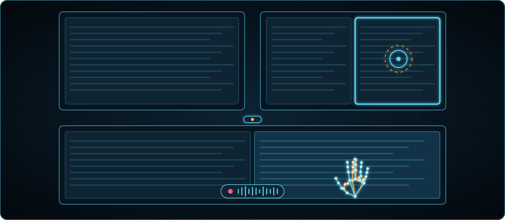

# Hyprwink

[English](README.md) · **Deutsch**

<p align="center"></p>

<p align="center"><b>Fenster anschauen – es hat den Fokus. Hand heben – es hört zu. Fenster in der Luft greifen – auf einen anderen Bildschirm werfen.</b></p>

Spracheingabe, Vorlesen, eigene Handgesten und „Fokus folgt Blick“ für
[Hyprland](https://hyprland.org) – mit einer normalen Webcam und einem Mikrofon.
Oberfläche, Spracheingabe und Sprachausgabe je auf Englisch oder Deutsch.

> [!WARNING]
> **Für mein Setup gebaut – rechne damit, es an deins anzupassen.**
> Hyprwink ist auf meinen eigenen Rechner zu Hause abgestimmt: Arch Linux, Hyprland, Quickshell-Leiste im
> Omarchy-Aufbau, drei Monitore (zwei oben, ein breiter unten, die Webcam dazwischen), NVIDIA-GPU. Dort
> läuft es richtig gut; bei dir muss sehr wahrscheinlich einiges angepasst werden – Monitoraufbau,
> Tasten, Leiste, Kamera, Schwellwerte. Am einfachsten zusammen mit Claude Code oder einem anderen
> Coding-Agenten: diese README und den Code lesen lassen und dann auf dein Setup feinabstimmen.
>
> Ich bin kein professioneller Programmierer – Hyprwink ist „vibe-coded“, also zusammen mit einer KI
> (Claude Code) entstanden. Nutzung auf eigenes Risiko; forken ausdrücklich erwünscht.

## Funktionen

<p align="center"></p>

### Spracheingabe
- **Strg+Leertaste** startet und beendet die Aufnahme, der Text wird ins Fenster mit Fokus eingefügt.
- Während der Aufnahme belegt Hyprwink **Esc** (abbrechen, auch noch beim Umwandeln) und **Enter**
  (beenden und senden); sonst gehen beide Tasten wie gewohnt an die Programme.
- Laufende Medien (MPRIS) pausieren während der Aufnahme. Aufnahme über PipeWire, 16 kHz mono, höchstens 5 min.
- Umwandlung lokal mit Whisper `large-v3-turbo` (faster-whisper; NVIDIA-GPU, sonst CPU; Stille wird verworfen)
  oder in der Cloud mit ElevenLabs Scribe v2 (fällt bei Fehlern auf Whisper zurück).
- Auf Webseiten (Chats, claude.ai, …) springt der Cursor beim Start ins Textfeld, wenn er in keinem steht
  (Barrierefreiheits-Schnittstelle, siehe Vorlesen).
- Einfügen wie ein Tippen: Zwischenablage sichern, Text kopieren, Strg+V (im Terminal Umschalt+Einfg),
  beim Senden Enter, alte Zwischenablage zurück.
- Eine Pille unten auf dem Bildschirm zeigt den Pegel beim Aufnehmen und einen Kreis beim Umwandeln (Quickshell).

### Sprachausgabe (Vorlesen)
- Liest aus dem Fenster mit Fokus (das, auf das du schaust): neu markierten Text, sonst die letzte
  Antwort von Claude Code in diesem Terminal (Zuordnung über den Prozessbaum), sonst die neueste
  Nachricht der Webseite dort (Chats, claude.ai, …), gefunden über die Barrierefreiheits-Schnittstelle
  (AT-SPI), ohne Regeln pro Seite.
- Stimme lokal mit Piper (englische und deutsche Stimmen, wird bei Auswahl geladen) oder in der Cloud mit
  Fish Audio (Stimme per ID oder Link; fällt bei Fehlern auf Piper zurück).
- Tempo 0,5–2,5×, auch während des Vorlesens änderbar. Alle Stimmen gleich laut (Pegel wird angeglichen).

### Gesten
- Eigene Gesten aufnehmen, eine Hand oder beide:
  - **Haltung:** eine Handform, kurz ruhig gehalten (Aufnahme 6 s, dabei leicht variieren).
  - **Bewegung:** eine Handform plus Bewegung, z. B. beide Hände auseinanderziehen; bei der Aufnahme
    3-mal machen. Erkannt wird sie unabhängig von Tempo und Größe, sobald die Hände stillstehen oder
    das Bild verlassen.
  - Gespeichert werden Handformen bzw. Bewegungswege, ein Foto und ein kurzer Clip; dazu eine
    Beschreibung („rechte Hand: Faust“, „beide Hände: … · auseinander“).
- Beim ersten Start gibt es Beispielgesten (meine eigenen Aufnahmen, ohne Fotos): rechte offene Hand
  startet die Spracheingabe, linke offene Hand liest vor, Faust bricht Diktat und Vorlesen ab (kein Esc),
  beide Zeigefinger schließen das Fenster, Zeige- und Mittelfinger aneinander schieben Fenster. Beliebig ändern, neu aufnehmen oder löschen.
- Jede Geste bekommt eine Aktion:
  - Spracheingabe: Aufnahme starten / beenden / beenden und senden; Vorlesen / Vorlesen beenden; Diktat und Vorlesen
    abbrechen (drückt nie Esc)
  - Tasten: Enter (sendet beim Diktat), Esc (bricht Diktat und Vorlesen ab), Tab, Alles markieren, Kopieren,
    Ausschneiden, Einfügen, Rückgängig (im Terminal mit den Terminal-Kürzeln)
  - Fenster: schließen, Vollbild an / aus, schwebend, nächstes Fenster, nächste / vorige Arbeitsfläche;
    auf den Monitor in Wischrichtung schieben, wie auf einem Touchscreen: greifen (aufgenommene Handform
    zeigen, kurz halten), ziehen (beliebig schnell), loslassen (andere Handform); Hand aus dem Bild nehmen
    bricht ab. Die Richtung rastet auf 8 ein (schmale gerade ±15°, breite schräge) und zeigt vom Fenster
    aus auf einen Monitor, wie beim Hinüberziehen; hoch oder runter: die Bildseite der Hand entscheidet;
    liegt dort kein Monitor, rückt das Fenster im Layout weiter (zwei nebeneinander tauschen). Aufnahme:
    nur die Handform, gehalten wie eine Handform-Geste mit der Hand, mit der sie benutzt wird
  - Medien: Wiedergabe/Pause, nächster / voriger Titel, lauter, leiser, Ton aus/an
  - ein beliebiges Tastenkürzel (ein eigenes Hyprland-Kürzel wird per wtype getippt, damit Hyprland es
    ausführt), ein Programm starten oder einen Befehl ausführen
  - ein eigener Wunsch als Text: wird nur gespeichert; Claude Code setzt ihn auf Zuruf um
- Eine Geste zählt erst wieder, wenn sie 1 s weg war (beim Halten flackert die Erkennung).
- Eine Hand, die vom Bildrand abgeschnitten ist (beim Runternehmen), macht keine Geste; eine Handform
  zählt auch nicht beim Ziehen (greifen – ziehen – loslassen) und 1 s nach dem Loslassen.
- Mehrere Gesten dürfen dieselbe Aktion haben; ähnelt eine neue Geste einer vorhandenen, kommt eine Warnung.
- Reiter „Gesten“ nach Aktionen gegliedert, Reihenfolge per Ziehen am Griff.

### Fokus folgt Blick
- Das Fenster, auf dem der Blick bleibt, bekommt den Fokus (Reaktion schnell 0,15 s, mittel 0,3 s, langsam 0,5 s).
- Auch ein Monitor ohne Fenster bekommt den Fokus, wie mit der Maus: ein neues Fenster (Kürzel, Geste) öffnet
  sich dort, wo du hinschaust.
- Kein Springen an Kanten: ein anderes Fenster zählt erst deutlich innerhalb; ein Fenster auf einem
  anderen Monitor erst 150 px hinter dessen Rand und nach doppelter Wartezeit.
- Die Maus hat Vorrang: während sie sich bewegt und 0,5 s danach wechselt der Blick den Fokus nicht.
- Selbstkorrektur im Betrieb: Mauszeiger und selbst gewechselte Fenster zeigen, wo der Blick wirklich ist.
- Kalibrierung mit Punkten auf allen Monitoren, beliebig viele, angeordnet und gedreht: Durchgang 1 voll,
  danach beliebig viele kurze aus anderen Sitzpositionen; Durchgänge einzeln löschbar oder später
  ergänzbar. Neu nötig, wenn Kamera oder Monitore verschoben werden.
- „Blickpunkt anzeigen“ zeigt den erkannten Blick als Punkt (zum Testen).

### Bedienung
- **Win+G** oder Linksklick aufs Leistensymbol: Kamera an/aus (Gesten und Blick). Spracheingabe und
  Sprachausgabe gehen auch bei ausgeschalteter Kamera.
- **Win+Alt+G**: Einstellungen zeigen/verstecken. Rechtsklick aufs Leistensymbol: Fenster mit den Reitern
  Kamera, Gesten, Einstellungen.
- Mini-Ansicht: kleines Kamerabild unten rechts, immer im Vordergrund.

### Einstellungen
- **Spracheingabe:** Anbieter (lokal oder Cloud), Sprache, bei Cloud der API-Schlüssel.
- **Sprachausgabe:** Anbieter, Sprache, Stimme (passend zur Sprache), bei Cloud der API-Schlüssel, Tempo, Probe.
- **Blick:** Schalter neben der Überschrift (Fokus folgt Blick, erst nach der Kalibrierung), Reaktion,
  Kalibrierung (Durchgänge aufklappbar), Blickpunkt anzeigen, inaktive Fenster abdunkeln (Stärke einstellbar, nur solange
  Fokus folgt Blick läuft; nutzt Hyprlands `dim_inactive`).
- **Allgemein:** Anzeigesprache (ohne Auswahl die des Systems; Vorgabe auch für Spracheingabe
  und Sprachausgabe), Design (Theme 1: Material Design 3; Theme 2: eckig,
  dünne Rahmen, Monospace), mit dem Computer starten, Kamera beim Start aus, Schließen minimiert,
  Mini-Ansicht, Konfiguration exportieren/importieren (eine ZIP-Datei mit Einstellungen, Gesten samt
  Aufnahmen und Blick-Kalibrierung; ohne API-Schlüssel; Importieren ersetzt alles).

## Voraussetzungen

- Eine beliebige Linux-Distribution mit **Hyprland ≥ 0.55 und Lua-Konfiguration** (mit der alten
  `hyprland.conf` gehen Tasten und Fensterbefehle nicht), systemd, PipeWire/WirePlumber, Webcam, Mikrofon
- Python ≥ 3.12, GTK 4 und libadwaita ≥ 1.5 mit Python-Anbindung, mpv, wl-clipboard, wtype, PortAudio, libsecret,
  AT-SPI, pipx:

  | Distribution | Pakete |
  |---|---|
  | Arch | `sudo pacman -S python-pipx python-gobject python-cairo gtk4 libadwaita mpv wl-clipboard wtype portaudio libsecret at-spi2-core` |
  | Fedora | `sudo dnf install pipx python3-gobject python3-cairo gtk4 libadwaita mpv wl-clipboard wtype portaudio libsecret at-spi2-core` (mpv aus RPM Fusion) |
  | Debian / Ubuntu | `sudo apt install pipx python3-gi python3-gi-cairo gir1.2-gtk-4.0 gir1.2-adw-1 mpv wl-clipboard wtype libportaudio2 libsecret-tools gir1.2-atspi-2.0` (ab Debian 13 / Ubuntu 24.04) |

- optional:
  - **Quickshell-Leiste im Omarchy-Aufbau** (`~/.config/quickshell/shell/` mit `plugins/`, `bar/Bar.qml`,
    `shell.qml`) für Leistensymbol, Diktier-Pille und Blickpunkt. Mit einer anderen Leiste fehlen nur
    diese; `hyprwink watch` liefert den Zustand als JSON für eigene Anbindungen.
  - **Claude Code** (Stop-Hook: letzte Antwort je Terminal zum Vorlesen)
  - Vorlesen von Webseiten in **Chromium-Browsern** (Chrome, Brave, …) braucht die Startoption
    `--force-renderer-accessibility` (z. B. eine Zeile in `~/.config/brave-flags.conf` oder
    `chromium-flags.conf`); Firefox gibt seine Seiten auch ohne heraus
  - **NVIDIA-GPU** (schnelle lokale Spracheingabe), Roboto-Schrift (Theme 1)
- Kopieren und Einfügen im Terminal (Strg+Umschalt+C, Umschalt+Einfg) kennt Ghostty, Kitty, Alacritty,
  foot, WezTerm, Konsole, GNOME Console/Terminal und xterm (`TERMINALS` in `src/hyprwink/core/hypr.py`).

## Installation

```sh
pipx install --system-site-packages "hyprwink[gpu] @ git+https://github.com/felixbk98/hyprwink"
hyprwink setup        # je Benutzer: Modelle, Dienste, Starter, Quickshell-Plugin, Claude-Code-Hook
hyprwink ui --setup   # erste Gesten aufnehmen
```

Ohne NVIDIA-GPU `hyprwink` statt `hyprwink[gpu]`. `--system-site-packages` nimmt GTK und libadwaita
aus dem System.

Tastenkürzel und Fensterregel der Mini-Ansicht kommen in die eigene Hyprland-Konfiguration:
siehe [`src/hyprwink/data/hyprland.lua`](src/hyprwink/data/hyprland.lua) (`hyprwink setup` zeigt den Pfad).

| Kürzel | |
|---|---|
| Strg+Leertaste | Spracheingabe an/aus |
| Esc / Enter | beim Diktat: abbrechen / beenden und senden (nur dann belegt) |
| Super+G | Hyprwink (Kamera) an/aus |
| Super+Alt+G | Einstellungen |

Mehr braucht Hyprwink nicht von deinen Tastenkürzeln: die Gesten-Aktionen (Fenster, Arbeitsflächen,
Medien, Lautstärke) sprechen Hyprland direkt an und funktionieren unabhängig von deinen eigenen Kürzeln.
Nur die Aktion „Tastenkürzel“ tippt die Kombination, die du dort einträgst.

Aktualisieren: `pipx upgrade hyprwink`, dann `hyprwink setup`. Entfernen: `hyprwink remove`
(je Benutzer: Dienste, Starter, Daten, Schlüssel, Einbindungen), dann `pipx uninstall hyprwink`.

## Befehle

```
hyprwink status [--json]                               Zustand
hyprwink pause | resume | toggle                       Kamera aus / an / umschalten
hyprwink reload                                        Gesten und Einstellungen neu laden
hyprwink dictate toggle|start|stop|send|cancel [--file F] [--badge B]
                                                       Spracheingabe (--file: Text in Datei statt einfügen,
                                                       --badge: Symbol in der Pille, für andere Programme)
hyprwink action <name>                                 Aktion auslösen wie per Geste
hyprwink actions                                       eingebaute Aktionen
hyprwink watch                                         Zustand fortlaufend als JSON-Zeilen (für Leisten)
hyprwink hook                                          Stop-Hook für Claude Code
hyprwink export | import <datei.zip>                   Konfiguration sichern / übernehmen (ersetzt alles)
hyprwink setup | remove                                für diesen Benutzer einrichten / entfernen
hyprwink ui [--setup | --settings | --mini | --toggle]
                                                       Fenster (--settings: Einstellungen zeigen/verstecken)
```

## Dateien

| Ort | Inhalt |
|---|---|
| `~/.config/hyprwink/settings.json` | Einstellungen aus dem Fenster |
| `~/.config/hyprwink/config.toml` | Feinabstimmung (optional, Vorgaben in `src/hyprwink/default_config.toml`) |
| `~/.config/hyprwink/gestures.json`, `samples.json`, `photos/` | Gesten: Name und Aktion, Aufnahmen, Fotos und Clips |
| `~/.config/hyprwink/gaze.json`, `gaze-samples.json` | Blick-Kalibrierung und ihre Messwerte (keine Bilder) |
| `~/.config/systemd/user/hyprwink-{core,vision}.service` | die beiden Dienste (von `hyprwink setup`) |
| `~/.local/share/applications/io.github.felixbk98.hyprwink.desktop` | Starter (von `hyprwink setup`) |
| `~/.cache/hyprwink/` | Modelle (Hand, Gesicht, Whisper), Piper-Stimme; werden bei Bedarf neu geladen |
| `$XDG_RUNTIME_DIR/hyprwink/` | Sockets, Zustand der Spracheingabe (`dictation`), Claude-Code-Antworten |
| Schlüsselbund (Secret Service) | API-Schlüssel: `service=hyprwink`, `account=fish-audio` / `elevenlabs` |

## Aufbau

Zwei systemd-Benutzerdienste, verbunden über Unix-Sockets (JSON-Zeilen):

- **hyprwink-vision** (`src/hyprwink/vision/`): Webcam → MediaPipe-Handpunkte → eigene Gesten,
  Gesicht → Blickpunkt. Nimmt Gesten auf und kalibriert den Blick.
  - `features.py` Handform als Merkmale (Beugung der Finger, Daumen, Richtung jedes Fingers im Bild)
  - `templates.py` Vergleich mit den Aufnahmen; was keiner ähnelt, löst nichts aus; Zweihand-Gesten haben Vorrang
  - `tracker.py` eine Haltung zählt erst, wenn sie kurz ruhig gehalten wird
  - `motion.py` Bewegungen: herausschneiden (Start bis Stillstand), Weg und Handform vergleichen
  - `drag.py` greifen – ziehen – loslassen (Fenster in Wischrichtung schieben)
  - `describe.py` Beschreibung der Handform in Worten (nur zur Kontrolle)
  - `gaze.py` Blickstrahl in 3D (Kopfposition und -richtung + Iris) → Schnitt mit der Kameraebene →
    eigene Abbildung je Monitor; Blinzeln wird übersprungen, Blickpunkt = Median der letzten Bilder
- **hyprwink-core** (`src/hyprwink/core/`): führt Aktionen aus, Zustand für Fenster und Leiste.
  - `engine.py` Geste → Aktion, Status; `actions.py` führt Aktionen aus; `media.py` Player und Lautstärke
  - `dictation.py` Spracheingabe; `reader.py` Vorlesen; `page.py` neueste Nachricht einer Webseite
  - `stt/` Spracherkennung (`whisper.py`, `elevenlabs.py`), `tts/` Sprachausgabe (`piper.py`, `fishaudio.py`),
    `providers.py` was sie teilen (Fehler, API-Schlüssel)
  - `gazefocus.py` Fokus folgt Blick; `hypr.py` Zugriff auf Hyprland (`hyprctl`)
- **Fenster** (`src/hyprwink/ui/`, GTK4/libadwaita): `camera_page.py`, `gestures_page.py`, `settings_page.py`,
  `calibration.py`; `style.py` die beiden Designs.
- **Gemeinsam** (`src/hyprwink/`): `settings.py` Einstellungen, `gestures.py` Gesten und Aktionen,
  `config.py` Laden/Speichern, `paths.py` Orte, `ipc.py` Sockets, `models.py` Modelle, `i18n.py` Sprachen,
  `integration.py` Einrichten/Entfernen je Benutzer, `backup.py` Export/Import,
  `answers.py` Claude-Code-Antworten, `cli.py` Befehle.
- **Einbindungen**: `src/hyprwink/data/` Vorlagen für Dienste und Starter, Hyprland-Beispiel, `examples/` Beispielgesten;
  `src/hyprwink/quickshell/` Quickshell-Plugin (Leistensymbol mit Blickpunkt, Diktier-Pille).
- **Bilder**: `docs/` Banner und Demo (animiertes SVG).

### Sprachen

Im Code stehen alle Texte auf Englisch, markiert mit `_("…")` (übersetzt) oder `N_("…")` (nur
markiert, übersetzt beim Anzeigen); `i18n.py` wählt die Sprache. Übersetzungen sind gettext-Dateien in
`po/` (`hyprwink.pot` = alle Texte, `de.po` = Deutsch); kompiliert liegen sie in `src/hyprwink/locale/`
(mit im Repository, damit pipx sie mitinstalliert).

```sh
xgettext -L Python --from-code=UTF-8 -k_ -kN_ -kngettext:1,2 --add-comments=Translators \
  --add-location=file -o po/hyprwink.pot $(find src -name '*.py' | sort)   # Texte sammeln
msgmerge -U --backup=none po/de.po po/hyprwink.pot                          # Übersetzung abgleichen
msgfmt -o src/hyprwink/locale/de/LC_MESSAGES/hyprwink.mo po/de.po          # kompilieren
```

Neue Sprache: `msginit -i po/hyprwink.pot -l <code> -o po/<code>.po`, übersetzen, kompilieren,
Namen in `i18n.NAMES` eintragen. Für die Sprachausgabe braucht sie außerdem Piper-Stimmen in
`LANGUAGE_VOICES` (`src/hyprwink/core/tts/piper.py`).

### Weitere Anbieter

Ein Anbieter ist ein Modul in `core/stt/` oder `core/tts/` plus ein Eintrag in `PROVIDERS` der
`__init__.py`; dort steht, was das Modul bereitstellen muss. Die Einstellungen bauen Anbieterliste,
Stimme und API-Schlüssel daraus selbst. Fällt ein Cloud-Anbieter aus, übernimmt der lokale.

## Entwicklung

Direkt aus dem Quellcode (Änderungen gelten sofort):

```sh
venv=~/.local/share/hyprwink/venv
python -m venv --system-site-packages $venv
$venv/bin/pip install -e '.[gpu]'
ln -s $venv/bin/hyprwink ~/.local/bin/hyprwink
hyprwink setup
```

Nach einer Änderung: `systemctl --user restart hyprwink-core hyprwink-vision`, Fenster neu öffnen.
Tests: `$venv/bin/pip install pytest && $venv/bin/python -m pytest`.

## Lizenz

MIT
